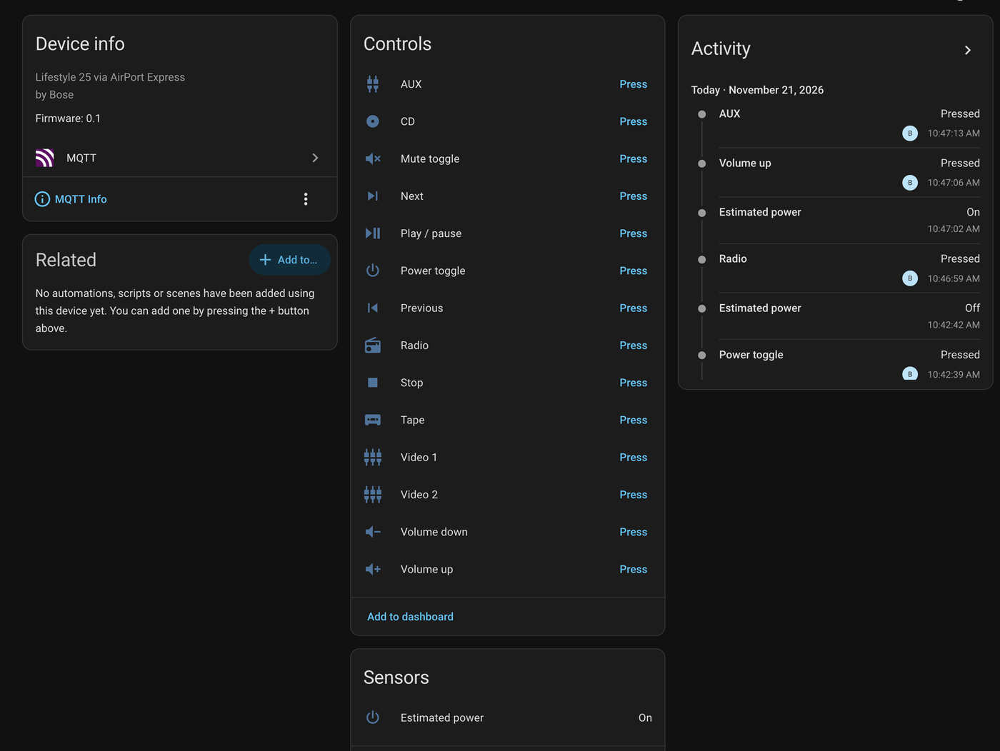

# Home Assistant → AirPort Express → Bose Lifestyle

Give an old **Apple AirPort Express** a second job: controlling a **Bose Lifestyle 25** from Home Assistant, over Wi-Fi and MQTT.

This project grew out of a working system made entirely from hardware already on hand. No Raspberry Pi, ESP32 or replacement operating system: the AirPort keeps running Apple's NetBSD-based firmware, with a small, specific patch and two native programs.


**Working on the original system:** power toggle, AUX/Radio selection, volume in both directions, MQTT discovery, and automatic startup. Home Assistant gets command buttons and an explicitly **estimated** power sensor. Actual power and volume readback have not been established.



*The original installation in Home Assistant. “Firmware 0.1” is the bridge version; the AirPort itself runs 7.6.2. Power is explicitly labelled as an estimate.*

> **Experimental and deliberately narrow.** This patch supports **AirPort Express A1392, firmware 7.6.2**, and the specific PL2303 descriptor profile below. It changes firmware and disables USB printer sharing. Read the [hardware guide](docs/hardware.md) and [recovery limits](docs/recovery.md) first. The installer refuses other firmware rather than guessing offsets or downgrading it.

## How a printer port became a Bose controller

The AirPort already had most of the machinery we needed. Its USB port could talk to printers, its Wi-Fi worked, and its firmware could run small programs. What it lacked was a driver that recognised our USB serial adapter.

Root SSH let us inspect the running system, its USB devices and the kernel in memory. We found that Apple's existing USB printer driver already supported the bulk data transfers our serial adapter needed. The obstacle was the driver's “is this a device I should handle?” check.

Instead of writing a whole new operating system or serial driver, we replaced that one matching routine. The replacement recognises only the tested PL2303 adapter and lets the existing driver handle its USB data pipes. A native helper configures the adapter's baud rate and sends Bose commands through those pipes.

The live kernel would not allow the required memory writes. **The installed patch is therefore a firmware patch, not a temporary SSH command that edits live kernel memory.** The tool modifies a 120-byte function region in the matching firmware image, repacks it, and verifies that the resulting image is exactly the one tested on hardware. It also adjusts two startup scripts so the controller starts after a reboot. SSH transfers the programs and private configuration; Apple's ACP update command writes the primary firmware bank.

A second small program connects to your MQTT broker. Pressing a Home Assistant button sends a command to the AirPort, which speaks the Bose's old serial protocol and publishes the acknowledgement. The AirPort initiates the MQTT connection; it doesn't expose an extra HTTP or TCP control server.

## What you need

| Item | Requirement |
|---|---|
| AirPort | **Express A1392**, the 2012 square model with two Ethernet sockets, running **7.6.2** |
| USB serial adapter | **PL2303HX-compatible**, USB `067b:2303`, device release `0300`, USB version `0110`, endpoint-zero packet size 64; exact endpoint layout checked by setup |
| Serial electrical interface | **TTL**, compatible with the Bose's 5 V serial interface; verify the particular adapter board's TX level and RX tolerance |
| Bose cable | **3.5 mm TRS stereo male** plug or screw-terminal breakout, plus TX/RX/GND connections |
| Bose | Lifestyle 25/CD20 music centre with `SERIAL DATA`; the CD20 specification requires firmware 6.1 or later |
| Home network | An MQTT broker reachable by private IPv4 address and Home Assistant's MQTT integration |
| Setup computer | macOS or Linux, Python **3.12+**, OpenSSH, Docker, and internet access for build inputs |

The chip name alone is insufficient: newer PL2303 variants, FTDI, CP210x and CH340 adapters are **not supported by this patch**. The USB identity also does not prove electrical compatibility. See [the complete wiring guide and diagram](docs/hardware.md).

## Install

Configure the AirPort with AirPort Utility first. Ethernet is useful during setup; joining an existing Wi-Fi network through AirPort Utility worked on the tested unit. Record its address and administrator password, and arrange a DHCP reservation. Skip firmware updates. A different AirPort firmware version needs separate research; this tool does not downgrade it.

```sh
git clone https://github.com/harrylepotter/ha-airport-express-bose-lifestyle.git
cd ha-airport-express-bose-lifestyle
python3 -m venv .venv
. .venv/bin/activate
python3 -m pip install -r requirements.txt

# Build and verify everything offline before changing the AirPort.
# Use a different stable device ID for each AirPort.
python3 airport_bose.py prepare --device-id living_room
```

Preparation downloads stock firmware directly from Apple, and NetBSD headers/libraries from their official archive. Every download is checked against a pinned SHA-256. Apple firmware, patched firmware, compiled binaries, backups and credentials are **not distributed in this repository**. They stay under the ignored `.local/` directory.

Replace `192.168.1.50` below with your AirPort's address:

```sh
# Only if SSH is not already enabled. This prompts, changes dbug, and reboots.
python3 airport_bose.py enable-ssh --host 192.168.1.50

# Wait for the reboot, then install. Keep the Bose disconnected during setup.
python3 airport_bose.py install --host 192.168.1.50 --device-id living_room
```

The installer walks through:

1. Verifying the model, firmware, running kernel and both firmware banks.
2. Asking for your MQTT broker address, port, username and hidden password. It checks broker authentication **through the AirPort** without publishing commands.
3. Inspecting the USB adapter with the Bose disconnected, then checking that the adapter is unplugged before patching and rebooting.
4. Saving all five flash partitions privately, including their sizes and hashes.
5. Showing the exact target, image hash, topic and recovery directory before the `INSTALL` confirmation.
6. Installing the programs and a mode-600 MQTT configuration, uploading the patched primary bank once, and reading it back in full. The secondary bank must remain unchanged.
7. Offering a separate reboot only after verification succeeds.

Passwords are entered interactively. The SSH login may ask for the AirPort administrator password again. No password is placed in a command line, generated firmware, public report or Git commit.

After the AirPort returns:

```sh
python3 airport_bose.py status --host 192.168.1.50 --device-id living_room
```

This checks the running kernel patch and MQTT startup. It doesn't send a Bose command. Then follow the [connection procedure](docs/hardware.md#connecting-the-cable), reconnect USB, and look for **Bose Lifestyle 25** in Home Assistant's MQTT devices. Device availability becomes online when the expected adapter is attached.

Need a different broker later?

```sh
python3 airport_bose.py configure-mqtt --host 192.168.1.50
```

This prompts for new MQTT details, verifies authentication, and restarts only the bridge. No firmware update is needed. For Docker installations using a named context, append `--docker-context desktop-linux` to `prepare` or `install`.

## Home Assistant and MQTT

Add the [MQTT integration](https://www.home-assistant.io/integrations/mqtt/) using the same broker. Discovery creates 14 buttons, a last-result sensor, and an estimated-power sensor. There is no pretend volume slider or measured on/off switch.

For device ID `living_room`, topics are:

| Topic | Meaning |
|---|---|
| `bose/living_room/command` | Command text, QoS 0, **retain false** |
| `bose/living_room/result` | Acknowledgement/error JSON, not retained |
| `bose/living_room/state` | Retained command-derived estimate |
| `bose/living_room/availability` | Retained online/offline, with an offline last will |

Commands: `power_toggle`, `volume_up`, `volume_down`, `mute_toggle`, `aux`, `cd`, `fm`, `tape`, `video1`, `video2`, `play_pause`, `stop`, `previous`, `next`.

```yaml
action: mqtt.publish
data:
  topic: bose/living_room/command
  payload: aux
  qos: 0
  retain: false
```

Each volume press sends five acknowledged steps. Other controls send one command. Failed or uncertain serial commands are never retried, and a volume burst stops at the first failed step. Allow about four seconds for a volume press to complete. `fm` means the Bose's Radio/AM-FM key; it can change bands.

**State is an estimate.** Source selection implies power on; power toggle changes a known estimate. Startup, reconnect, failures and expiry can return it to unknown. Actions on the original remote are not observed. USB availability means the adapter and broker are available, not that the Bose is powered on. More details: [protocol and limitations](docs/protocol.md).

## How the power sensor works

The Bose has one **power toggle** command, rather than separate “on” and “off” commands. We found no supported way to ask this CD20 for its actual power state. The sensor keeps a small record of what the controller has good reason to expect.

The useful clue is source selection: Bose documents that selecting a source also turns the system on. Once the Bose acknowledges AUX or Radio, the bridge has a starting point: **estimated on**. An acknowledged power toggle then flips that estimate to off; another flips it back to on.

| Event | Estimated power | Why |
|---|---|---|
| Bridge starts | Unknown | It has no current observation |
| Bose acknowledges AUX | On | Selecting a source also powers on |
| Bose acknowledges power toggle | Off | The last estimate was on |
| Bose acknowledges power toggle again | On | The last estimate was off |
| Toggle while the estimate is unknown | Unknown | A toggle alone cannot establish the starting state |
| Failed command, reconnect or missing adapter | Unknown | The previous assumption may no longer hold |
| 20 minutes without an estimate update | Unknown | An old estimate should not appear reliable forever |

This is more useful than blindly changing a dashboard when a button is pressed: the update waits for the **Bose's serial acknowledgement**, and an uncertain exchange invalidates the estimate. The MQTT state explicitly includes `estimated: true` and `feedback_supported: false`, and the HA entity is named **Estimated power**.

There are limits. Acknowledgement means the command interface accepted a command, not that a power sensor measured the amplifier. The physical remote, front-panel buttons, mains interruptions and automatic standby can change reality without notifying this bridge. Selecting a source through HA gives it a fresh starting point. It does not silently assume “off” after a reboot, and it does not offer separate on/off actions that would be unsafe to infer from a stale toggle state.

The implementation is small enough to read: [the state logic](native/airport-bose-state.h), [the MQTT updates](native/airport-bose-mqtt.c), and [the fault/estimate tests](tests/test_native.py). See also the [Bose owner's guide](https://products.bose.com/pdf/customer_service/owners/og_ls25_s1.pdf), “Turning the system on,” and [our protocol notes](docs/protocol.md).

## Validation and boundaries

The original A1392/Bose pair verified serial traffic, stable AUX/Radio audio, both HA volume buttons, power toggle, MQTT discovery and automatic startup. Its firmware reboot test used USB disconnected. The public installer reproduces that exact firmware image and has offline build and fault-injection tests. Its packaged status and USB descriptor checks were also run on the working AirPort, without sending Bose commands. It has **not** been used to reflash a second unit or to re-run the complete fresh-install journey on the working system.

The Lifestyle 20 and 30 share the CD20 protocol according to Bose, but have not been tested here. Other AirPort models/firmware and PL2303 revisions are outside this release. This is not a general USB serial driver or a maintained replacement router firmware. Use the AirPort and the unencrypted MQTT/ACP protocols only on a trusted LAN; don't forward their ports to the internet.

```sh
python3 -m unittest discover -s tests -p 'test_host.py' -v
python3 tests/test_native.py
```

See [recovery](docs/recovery.md), [development](docs/development.md), and the [100-word overview](docs/overview.md).

## Credits and licence

MIT-licensed project code; third-party notices are preserved in [NOTICE.md](NOTICE.md).

- [TDSOJohn/airport-express-tools](https://github.com/TDSOJohn/airport-express-tools): AirPort access, firmware format, filesystem reader and cross-compilation groundwork.
- [x56/airpyrt-tools](https://github.com/x56/airpyrt-tools): ACP protocol implementation underlying that work.
- [LiamBindle/MQTT-C](https://github.com/LiamBindle/MQTT-C): the native MQTT client library.
- [NetBSD](https://www.netbsd.org/): headers, libraries and USB interfaces.
- [Bose CD20 Serial Control Rev. 4](https://id.scribd.com/document/58620095/CD20-Serial-Control-Rev4) and the [original serial-controller experiment](https://github.com/harrylepotter/bose-lifestyle-remote): protocol groundwork.

Apple and Bose are trademarks of their respective owners. This is an independent reuse project.
