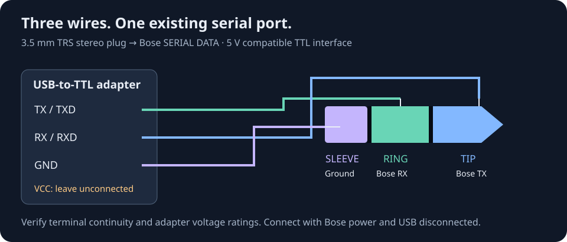

# Hardware and the Bose serial cable

## Required adapter

The tested adapter enumerates as a **Prolific PL2303HX-compatible** USB-to-TTL device:

| Descriptor | Required value |
|---|---|
| Vendor/product | `067b:2303` |
| Device release (`bcdDevice`) | `0300` |
| USB version (`bcdUSB`) | `0110` (USB 1.1) |
| Endpoint-zero maximum packet | 64 bytes |
| Configuration/interface | Configuration 1, interface 0, alternate 0 |
| Bulk OUT / IN | `02` / `83`, maximum packet 64 |
| Interrupt IN | `81` |

The installer checks these before flashing. A listing saying “PL2303”, “USB serial” or “5V” does not establish this complete profile. HXD, TA, GC and other revisions are not interchangeable here. Some adapters expose RS-232 levels through a DE9 connector; those are unsuitable for direct connection.

**Electrical compatibility is a separate requirement.** Bose describes the CD20 interface as 5 V, idle high. Verify the actual board's TX output level and RX tolerance from its documentation; a 5 V power pin or jumper may select only the power output, not its UART levels. If your adapter cannot safely receive the Bose's 5 V output, use an appropriate UART level interface. Do not connect it directly on the strength of the chip name. The original project reused an exact adapter/cable pair that had already controlled the same Bose successfully.

No oscilloscope is required for checking a plug's continuity or static voltage with a multimeter, but a multimeter reading alone does not establish a receiver's maximum rating. Do not change the proven cable's wiring unnecessarily.

## The connector is 3.5 mm TRS

Use a **3.5 mm stereo male plug**, with **three metal contacts and two insulating bands**, plugged into the music centre's rear **SERIAL DATA** jack. It is not a DC barrel power connector, mono TS plug, four-contact TRRS headset plug, or the AirPort's audio output.

| USB-to-TTL adapter | Bose plug contact | Direction at the Bose |
|---|---|---|
| **TX / TXD** | **Ring** (middle contact) | Serial input / SER-IN |
| **RX / RXD** | **Tip** (end contact) | Serial output / SER-OUT |
| **GND** | **Sleeve** (long contact nearest cable) | Signal ground |
| **5V / 3V3 / VCC** | **Leave unconnected** | The Bose supplies its own power |
| RTS / CTS / DTR | Leave unconnected | Not used by the three-wire protocol |

These are the adapter's own TX and RX labels: adapter TX goes to Bose RX. Screw-terminal breakouts can use inconsistent labels or terminal order; check continuity to the actual tip, ring and sleeve instead of relying on wire colour or which screw is leftmost. Do this with all equipment disconnected from power.

The electrical pinout and 1200 baud, 8 data bits, no parity, 1 stop bit come from [Bose CD20 Serial Control Rev. 4, sections 3.2–3.3](https://id.scribd.com/document/58620095/CD20-Serial-Control-Rev4). The documented connection is TTL, despite the document also using the term RS-232. **Never apply conventional positive/negative PC RS-232 voltages.**

## Connecting the cable

1. Complete the software installation and first reboot with the USB adapter disconnected. Run `status` and check MQTT startup.
2. Set the Bose to a low listening volume. Switch it off at the wall and keep the adapter's USB end unplugged.
3. Connect the verified three-wire cable to the Bose's **SERIAL DATA** jack. A TRS plug can briefly short contacts while being inserted, which is why connection is done unpowered.
4. Restore Bose power, then plug the adapter into the AirPort's USB-A port. No USB hub is required.
5. Use the HA AUX button while audio is available on AUX, or Radio with a known station. Confirm the result by listening; an acknowledgement alone isn't proof of audible operation.

The original Bose display was dead, so audio and the working physical remote were used for testing. The cable carries control data only; it does not carry your music or connect the AirPort audio output to the Bose.
